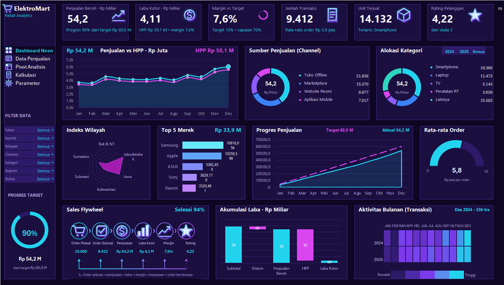
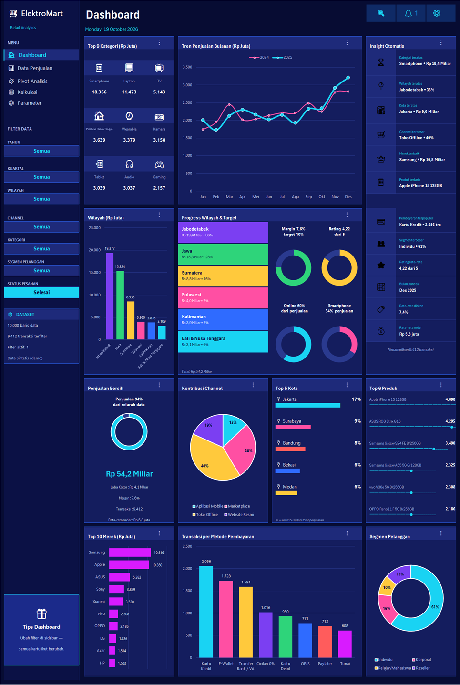

# ElektroMart Retail Analytics Dashboard

Dashboard analitik penjualan ritel elektronik **ElektroMart** yang dibuat di Microsoft Excel. Sumber datanya 10.000 baris transaksi periode 2024–2025. Semua kartu dan grafik berubah mengikuti filter di sidebar.

> Data bersifat **sintetis (fiktif)** dan dibuat untuk latihan analisis.

File: [`Elektromart-retail-analytics-dashboard.xlsx`](Elektromart-retail-analytics-dashboard.xlsx)

## Isi Workbook

| Sheet | Fungsi |
|---|---|
| **Dashboard Neon** | Dashboard utama bertema neon, berisi 6 KPI dan 10 grafik |
| **Dashboard** | Dashboard kedua: insight otomatis, wilayah, kota, produk, merek, dan metode pembayaran |
| **Data Penjualan** | Tabel transaksi (10.000 baris, 36 kolom), termasuk kolom formula untuk PPN, HPP, laba, dan margin |
| **Pivot** | Pivot analisis |
| **Kalkulasi**, **Kalkulasi Neon** | Perhitungan di belakang kartu dan grafik dashboard |
| **Parameter** | Asumsi yang bisa diubah: tarif PPN, target margin, target penjualan, skala gauge |

## Dashboard Neon

### Penjelasan KPI

| KPI | Nilai | Arti dan cara hitung |
|---|---|---|
| **Penjualan Bersih** | Rp 54,2 M | Total `Penjualan Bersih` setelah diskon, sebelum PPN dan ongkos kirim. Subjudul menunjukkan progres terhadap target (90% dari Rp 60,0 M). |
| **Laba Kotor** | Rp 4,11 M | Penjualan Bersih dikurangi `Total HPP` (Rp 50,1 M). |
| **Margin vs Target** | 7,6% | Laba Kotor ÷ Penjualan Bersih. Target margin 10% (di sheet Parameter), jadi capaiannya 76%. |
| **Jumlah Transaksi** | 9.412 | Jumlah transaksi yang lolos filter. Rata-rata order Rp 5,8 juta. |
| **Unit Terjual** | 14.132 | Total `Qty`. Kategori terlaris: Smartphone. |
| **Rating Pelanggan** | 4,22 | Rata-rata rating pelanggan, skala 1–5. |

### Grafik dan komponen lain

- **Penjualan vs HPP**: tren bulanan penjualan dan HPP. Selisih kedua garis adalah laba kotor.
- **Sumber Penjualan (Channel)**: porsi penjualan per channel (Toko Offline, Marketplace, Website Resmi, Aplikasi Mobile).
- **Alokasi Kategori**: porsi penjualan per kategori produk. Tombol 2024, 2025, dan Semua mengganti tahun.
- **Indeks Wilayah**: radar penjualan per wilayah.
- **Top 5 Merek**: lima merek dengan penjualan tertinggi.
- **Progres Penjualan**: penjualan kumulatif (garis solid) dibanding target (garis putus-putus).
- **Rata-rata Order**: gauge nilai rata-rata per order, dengan skala maksimal 10 juta.
- **Progres Target**: ring persentase pencapaian target penjualan (90%).
- **Sales Flywheel**: alur order masuk → selesai → penjualan → laba kotor → margin → rating. "Selesai 94%" artinya 9.412 dari 10.000 order berstatus selesai.
- **Akumulasi Laba (waterfall)**: Subtotal − Diskon = Penjualan Bersih − HPP = Laba Kotor.
- **Aktivitas Bulanan**: heatmap jumlah transaksi per bulan dan tahun.

## Dashboard

Dashboard kedua ini lebih berfokus pada ringkasan dan insight:

- **Top 9 Kategori**: penjualan (Rp juta) per kategori. Smartphone memimpin dengan Rp 18,4 M.
- **Tren Penjualan Bulanan**: perbandingan 2024 dan 2025.
- **Insight Otomatis**: ringkasan yang dihitung otomatis dari data terfilter, yaitu kategori, wilayah, kota, channel, merek, produk, pembayaran, segmen, rating, bulan puncak, rata-rata diskon, dan rata-rata order.
- **Wilayah & Progress Target**: penjualan per wilayah, ditambah ring Margin vs Target, Rating, Penjualan Online (porsi channel selain toko offline), dan porsi Smartphone.
- **Penjualan Bersih, Kontribusi Channel, Top 5 Kota, Top 6 Produk, Top 10 Merek, Metode Pembayaran, Segmen Pelanggan**: rincian lain per dimensi.

## Filter

Sidebar berisi filter **Tahun, Kuartal, Wilayah, Channel, Kategori, Segmen Pelanggan, dan Status Pesanan**. Status bawaannya adalah *Selesai*, jadi angka di dashboard hanya menghitung pesanan yang selesai.

## Parameter yang Bisa Diubah

Ubah di sheet **Parameter**:

| Parameter | Nilai bawaan |
|---|---|
| Tarif PPN | 11% |
| Target Margin Laba | 10% |
| Target Penjualan Tahunan | Rp 30.000 juta (asumsi, ganti dengan target Anda) |
| Skala maksimal gauge Rata-rata Order | Rp 10 juta |
